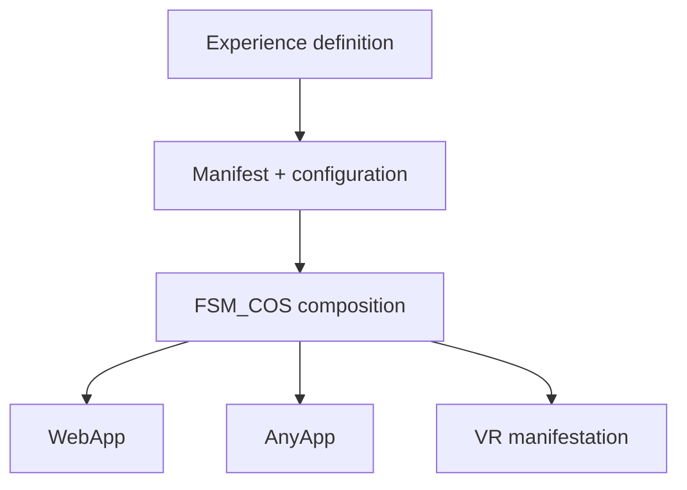
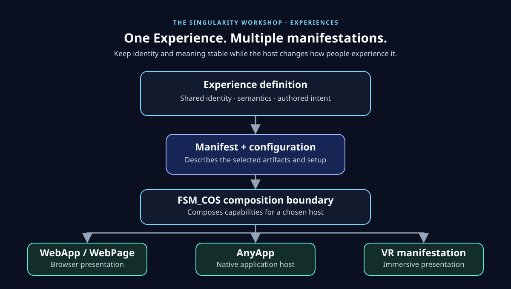
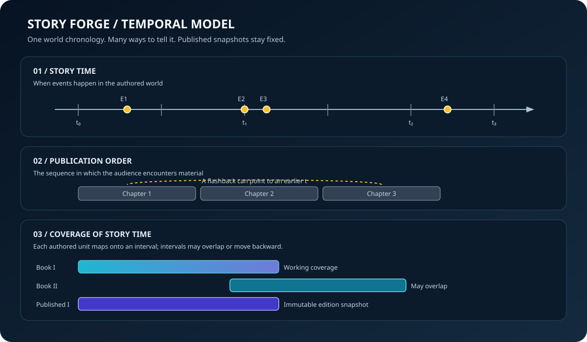

# The Singularity Workshop — Experiences

> **A home for independently authored Workshop Experiences and publishable MicroBundle artifacts.**

An Experience defines what is being experienced; WebApp, AnyApp, and VR are different manifestations of that shared experience—not separate definitions of it.

## 🟦 01 What

An Experience defines what is being experienced; WebApp, AnyApp, and VR are different manifestations of that shared experience—not separate definitions of it.

## 🟣 02 Why

An Experience should survive changes in presentation. Keeping the Experience and its artifacts independent lets browser, desktop, and VR hosts share identity and semantics while each host remains responsible for its own interaction and rendering.

## 🔺 03 How

Keep Experience semantics and artifact identity here; let hosts own presentation, FSM_COS own composition, and the repository own durable artifact delivery.

## 🟢 04 See it in a minute

Start with the MVP vertical slice and publication path documented below; use the listed tests and artifact checks before treating an Experience as publishable.

## 🟪 05 Documentation and theory

[Chemistry Laboratory — department floor and experiment journey](experiences/ChemistryLaboratory/README.md) · [Fluid Dynamics Laboratory — water, waves, terrain, and coupled-world roadmap](experiences/FluidDynamicsLaboratory/README.md) · [Singularity Exploratorium — playful discovery and first exhibits](experiences/SingularityExploratorium/README.md) · [Exploratorium exhibit directory](experiences/EXPERIENCE_DIRECTORY.md) · [Build to Illuminate](docs/BUILD_TO_ILLUMINATE.md) · [MVP vertical slice](#the-mvp-vertical-slice) · [Diegetic institutions and war games](experiences/DIEGETIC_INSTITUTIONS_DESIGN.md) · [History Museum preforge](experiences/HistoryMuseum/README.md) · [Siege Wing design](experiences/HistoryMuseum/SIEGE_WING_DESIGN.md) · [Castle Sieges booth design](experiences/HistoryMuseum/exhibits/CastleSieges/EXHIBIT_DESIGN.md) · [Castle Siege preforge home](experiences/CastleSiege/README.md) · [Sound Experiences and MicroBundles](experiences/Sound/README.md) · [Castle Siege Experience](experiences/CastleSiege/design/EXPERIENCE.md) · [Tabletop siege vertical slice](experiences/CastleSiege/design/TABLETOP_VERTICAL_SLICE.md) · [Castle Siege manifest](experiences/CastleSiege/manifest/MANIFEST.md) · [Celestial Mechanics Laboratory](experiences/CelestialMechanics/README.md) · [Drone Construction](experiences/DroneConstruction/README.md) · [Marble Run](experiences/MarbleRun/README.md) · [Domino Studio](experiences/DominoStudio/README.md) · [Physics/MicroBundle boundary](docs/MARBLE_RUN_AND_DOMINO_MICROBUNDLE_BOUNDARY.md) · [Publication](#publication) · [Artifact identity](#artifact-identity) · [Architectural rules](#architectural-rules) · [Engineering quality standard](docs/ENGINEERING_QUALITY_STANDARD.md)

---

## Detailed guide

This repository contains preforge Experience definitions, independent publishable Experiences, and MicroBundle artifacts for The Singularity Workshop. Each substantial Experience starts with its own authored home under `experiences/`; buildable projects under `src/` are implementation artifacts, not the Experience's source of truth.

It is deliberately separate from WebApp/WebPage, AnyApp, FSM_COS, MicroBundleRepository, GUI, and FSM_API.

## The central idea

An Experience is not a WebApp, not a desktop window, and not a VR scene.

An Experience can have multiple manifestations.

## Digitens populate the universe

Digitens are the Workshop's digital citizens and belong to the world across institutions and experiences—not to one isolated page or demo. They arrive and depart, occupy roles, work at places, and provide the familiar human-scale interactions through which visitors use the world: a bank teller at a bank, a shopkeeper at a store, a technician in a laboratory, or a guide in the Exploratorium.

Treat citizen identity, role, lifecycle, workplace/service association, and interaction contracts as meaningful state. Browser, desktop, and VR hosts may render the same citizen differently, but must not invent unrelated populations for each manifestation. A role is not a functioning service until its underlying capability exists and is verified; design previews and current population visuals must be labelled honestly.

The Experience layer describes the citizen and authored intent; FSM_COS composes the needed capabilities; domain systems own authoritative work and state; hosts present the encounter. Digitens should make the universe feel inhabited everywhere, while their actual jobs give the visitor a reason to engage.

    EXPERIENCE
        |
        +-------------+-------------+
        |             |             |
      WebApp        AnyApp       VR Client
      browser       Windows       headset
        |             |             |
        +-------------+-------------+
                      |
               shared identity
               shared session
               shared state

The WebApp is good at distribution, discovery, browser interaction, visualization, and WebXR.

AnyApp is good at local CPU/GPU resources, desktop-native services, local persistence, artifact caching, and heavier computation.

A future VR client can focus on tracking, rendering, input, and low-latency interaction while using AnyApp for suitable heavier local computation.

## Co-entangled manifestations

“Co-entangled” is our architectural shorthand for multiple manifestations participating in the same Experience context. It does not imply quantum entanglement.

Connected manifestations may share:

- Experience identity
- immutable artifact identity
- protocol version
- session identity
- capability information
- lifecycle state
- selected objects
- explicit user events
- derived state
- synchronization sequence numbers
- health/heartbeat information

Shared identity does not mean shared implementation.

The browser does not become WPF. The VR client does not become AnyApp. AnyApp does not become the WebApp.

They communicate through explicit contracts.

## The deployment path

The desired user journey is:

    WebApp
      |
      | user chooses an Experience
      v
    published Experience identity
      |
      | explicit request to open desktop companion
      v
    anyapp://experience/{id}/{version}/{contentHash}?token=...
      |
      v
    AnyApp
      |
      | verify request and resolve immutable identity
      v
    FSM_COS
      |
      v
    Experience running locally

The custom URI scheme is a launch mechanism, not an authority mechanism.

Opening AnyApp must never mean that the browser supplied executable code to the desktop. It means the browser requested that the desktop resolve an immutable Experience identity.

## The bridge

The first bridge is intentionally small:

    WebApp
      |
      | loopback WebSocket
      v
    AnyApp Bridge

Messages are versioned envelopes containing protocol version, message type, session ID, sequence number, timestamp, and payload.

Initial vocabulary:

- hello
- welcome
- experience.request
- experience.state
- heartbeat
- event
- error

The bridge is a communication boundary, not a remote shell.

It must never become arbitrary command execution, arbitrary filesystem access, arbitrary assembly loading from browser input, or an unrestricted localhost API.

## Security is part of the architecture

The WebApp-to-AnyApp relationship crosses a trust boundary.

The initial model is:

    PUBLIC WEB
        |
        v
    BROWSER
        |
        | constrained, authenticated bridge
        v
    ANYAPP
        |
        | verified artifacts
        v
    LOCAL RUNTIME

The bridge should establish origin policy, launch authentication, session binding, sequence validation, message limits, capability negotiation, command allowlisting, artifact verification, least privilege, and auditable significant events.

The desktop should assume browser input is untrusted until validated.

See docs/SECURITY_MODEL.md.

## VR is another manifestation

VR should not become a separate architecture.

    EXPERIENCE
        |
        +----------+----------+
        |          |          |
      WebApp     AnyApp     VR Client
                              |
                              v
                         headset/browser

WebXR is a useful browser-side manifestation boundary. The shared architectural concepts should remain above the renderer:

- Experience identity
- semantic intent
- observer
- capability
- interaction
- state
- synchronization

A VR camera implementation must not leak into GUI.Core or Experience semantics.

## Observer

A useful common abstraction is:

    Observer
      - position
      - orientation
      - viewport
      - visible extent
      - detail horizon
      - interaction horizon

WPF, browser rendering, WebXR, and future native VR can realize this differently.

The semantic layer describes what is observable and interactive. The renderer decides how to realize it.

## Publication

See [`docs/PUBLICATION.md`](docs/PUBLICATION.md) for the artifact boundary from Experience build output to repository-backed composition.

## Workshop Showcase — WebApp-hosted Experience

The initial repository-owned showcase definition lives in [`experiences/WorkshopShowcase`](experiences/WorkshopShowcase/README.md). It contains the versioned Experience manifest and the complete current six-entry demonstration catalog. This is the start of migrating showcase content out of WebPage; the WebPage host does not yet load these files through the repository at runtime.

The intended boundary is Experience-owned identity, journeys, content, and MicroBundle requirements, resolved by the host through the repository path and composed by FSM_COS. WebPage remains responsible for browser lifecycle, host manifest selection, and presentation adapters.

## Independent package seeds

The first independently buildable Experience payloads now live here rather than inside a host:

- `TheSingularityWorkshop.Experiences.Forge` — Forge MicroBundle, Experience 3201.
- `TheSingularityWorkshop.Experiences.Moniker` — static Moniker content MicroBundle, Bundle 3101, and the shared motion contract.
- `TheSingularityWorkshop.Experiences.Moniker.Motion.Wave` — independent wave presentation MicroBundle, Bundle 3102, composed by a Moniker Experience when desired.

They reference the published domain/composition/GUI contracts; they do not reference AnyApp source. AnyApp remains a host and consumer of published Experience artifacts.

## Atomic ontology corpus

The next test corpus is intentionally made from small semantic things:

- **Elements** — atomic element data with multiple possible presentations.
- **Digital Logic** — composable physical, combinational, sequential, modular, timing, programmable, and visualization bundles.
- **Software Design Patterns** — individually addressable patterns that can compose into larger pattern collections.

The repository should let these atoms remain independent while larger Experiences compose them. See issue #3 for the working extraction and test plan.

## Castle Siege — physical experiment and competitive play

Castle Siege is the planned physics-based build-and-destroy Experience: first a single-player, inspectable siege experiment, then an equal-kit construction duel with locked builds and alternating attacks. Its design contract assigns Experience identity and match rules here, physical outcomes to Physics, and scene/input/presentation to WebPage. The design is documented; a playable Castle Siege artifact and complete Physics-backed trajectory/impact loop are **not yet implemented**.

See [Castle Siege Experience design and implementation contract](experiences/CastleSiege/design/EXPERIENCE.md) and the [Physics experiment catalog](https://github.com/TrentBest/TheSingularityWorkshop.Physics/blob/development/docs/CASTLE_SIEGE_EXPERIMENT_CATALOG.md).

## Story Forge — temporal story authoring

Story Forge is being developed as a capability inside the Forge Experience. Its first domain library defines named story timelines, event markers, story-time ranges, publication coverage, and immutable published-edition snapshots.

The key distinction is between **when something happens in the story world** and **where a chapter or book chooses to present it**. Multiple timelines and coverage bands will let authors add flashbacks or earlier-discovered events without silently rewriting published editions.

The planned diegetic tools include a hashed 2D timeline, clickable event markers, chapter/book coverage lanes, a character workshop, an evidence/string board, temporal queries, and scene playback. The current code includes a renderer-independent temporal model and first temporal query engine with provenance-aware events, time-bounded entity state, proposal filtering, and explicit conflict reporting. The interactive timeline, character workshop, evidence/string board, scene planner, and host integration remain the next milestones.

See [Story Forge architecture](docs/STORY_FORGE_ARCHITECTURE.md) and [the project README](src/StoryForge/README.md).

## What belongs here?

This repository should contain things that can be independently built, versioned, published, and addressed as Experiences.

An Experience project should be able to:

1. build independently;
2. produce a deterministic artifact;
3. calculate an immutable content hash;
4. publish to MicroBundleRepository;
5. be referenced by an Experience manifest;
6. be retrieved by AnyApp;
7. be composed by FSM_COS;
8. be manifested by one or more hosts.

This repository should not become a copy of AnyApp, WebApp, FSM_COS, or the repository server.

## Artifact identity

An Experience manifest must eventually identify each required MicroBundle by immutable artifact identity:

    BundleId
    Version
    ContentHash

The hash is part of the identity of the consumed artifact.

That gives us:

    Experience
       |
       v
    Manifest
       |
       v
    BundleId + Version + ContentHash
       |
       v
    Repository
       |
       v
    verified bytes
       |
       v
    materialization
       |
       v
    FSM_COS

This is the seam that removes the temporary host-compiled MicroBundle catalog.

## Architectural rules

1. Identity before manifestation.
2. Manifest before execution.
3. Published artifacts are immutable.
4. Verify at every trust boundary.
5. WebApp, AnyApp, and VR communicate through versioned contracts.
6. A manifestation exposes only capabilities it actually has.
7. Local computation is an explicit capability.
8. Experience semantics remain renderer-independent.
9. Security comes before bridge convenience.
10. Keep the MVP small.

## The MVP vertical slice

The first complete path should be:

    Forge
      |
      v
    published Experience
      |
      v
    WebApp
      |
      | Open in AnyApp
      v
    AnyApp
      |
      | secure bridge
      v
    WebApp <----> AnyApp
      |
      +-- shared Experience identity
      +-- capability exchange
      +-- heartbeat
      +-- explicit events

Then, and only then:

    WebApp / AnyApp
           |
           v
       WebXR capable
           |
           v
        VR client

The Workshop is not building three unrelated applications.

It is building one Experience system with multiple doors into it.

See:

- docs/MANIFESTATION_ARCHITECTURE.md
- docs/SECURITY_MODEL.md
- docs/ROADMAP.md
- docs/STORY_FORGE_ARCHITECTURE.md

---

   
  <strong>The Singularity Workshop</strong> 
  <em>If a picture is worth a thousand words, what is a living picture worth?</em> 
  <a href="https://github.com/TrentBest">GitHub</a> · <a href="https://www.patreon.com/TheSingularityWorkshop">Support the Workshop</a>

