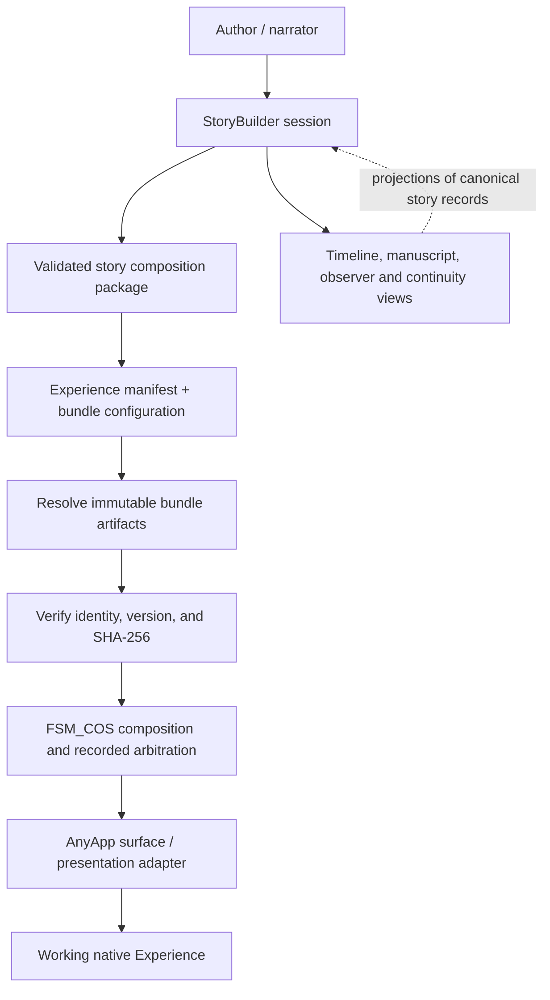

# StoryBuilder → Experiences → AnyApp: first runnable milestone

## Purpose

Prove that a story authored in StoryBuilder can be opened and operated as a real Experience in AnyApp. This is a vertical product slice, not a new composition architecture.

**Current status:** integration contract documented; the complete package-to-host path is not yet verified. See the acceptance checklist below before calling this end-to-end.

## Ownership

- **StoryBuilder** owns story composition and authoring records: characters, scenes, world events and claims, timeline placements, observer knowledge, and manuscript portrayals.
- **TheSingularityWorkshop.Experiences** owns reusable, host-independent Experience definitions and MicroBundle projects. An Experience describes what the user can do and the domain behavior that makes it real.
- **FSM_COS** owns host-boundary composition and arbitration. StoryBuilder's neutral MicroBundle must not depend on FSM_COS.
- **MicroBundleDomain / MicroBundleRepository** own the neutral bundle contract and immutable artifact delivery/identity respectively.
- **AnyApp** owns the desktop host, validation and consumption of an already captured manifest/package, and the native presentation adapter.
- **GUI / GUI.SVG / Renderer / Visualize** are presentation or observation providers, not the source of truth for story state.

StoryBuilder coordinates *authoring the plot*. It does not become the Experiences catalog, host runtime, or composition kernel.

## Data path

The package and manifest are distinct. The StoryBuilder workspace is mutable authoring state; the captured composition package records validated content and resolved decisions; the Experience manifest requests host composition; MicroBundle artifacts have their own immutable identity.

## First vertical slice

Start with a book/story, because it exercises the authoring model without requiring physics or 3D:

1. Create or open a StoryBuilder workspace in AnyApp.
2. Create a character, a scene, and a world event; give each a stable identity and preserve the source/provenance fields the model requires.
3. Place the event on a timeline and reference it from a scene or manuscript section. The event and its portrayal must be linked records, not duplicate copies of fictional truth.
4. Show the manuscript/scene content and the timeline in the native host. Selecting an event should reveal its source record and its portrayals.
5. Capture a versioned package, validate it, and produce the host-facing Experience manifest with explicit bundle versions and configuration.
6. Resolve and verify the package's immutable artifacts, compose through FSM_COS, and launch the resolved result in AnyApp.
7. Reopen the captured package and prove stable IDs, event-to-portrayal links, timeline placement, and manuscript order survive round-trip.

The first runnable slice can use local repository-source development mode. It must not pretend that local source loading proves repository-delivered artifact materialization.

## Existing integration facts and the remaining gap

- StoryBuilder's `StoryBuilderAuthoringBundle` implements the neutral `IMicroBundle` contract and declares bundle ID `0x53544F5259425549`, version `0.1.0`.
- Its current `CreateSession` creates an in-memory authoring session. The bundle itself is a stateless capability factory; the session/workspace is separate.
- AnyApp's `ExperienceManifest` already models a runtime ID, versioned bundle requests, optional configuration, and repository artifact identity (artifact version plus content hash).
- AnyApp's current `AnyAppMicroBundleCatalog` is a finite compiled catalog of known bundles. It does not yet resolve StoryBuilder's bundle by the declared identity.
- StoryBuilder's bundle does **not** itself implement AnyApp's `IAnyAppSurface`. A bundle ID registration alone therefore does not produce a working native UI.
- The StoryBuilder README/architecture describes a native StoryBuilder authoring launch in AnyApp. That is an authoring launch slice, not yet proof of the full validated-package → manifest → verified artifacts → FSM_COS → native Experience path.

## Implementation sequence

### 1. Establish the adapter seam

Inspect and test the actual AnyApp surface contract. Keep host-specific presentation code in a host adapter, not in StoryBuilder.Core and not in the neutral MicroBundleDomain contract. The adapter consumes the canonical StoryBuilder session/model and publishes commands and projections without owning the underlying story state.

### 2. Define the captured package boundary

Use the existing StoryBuilder package compiler/reader and FSM_Serialization binary contract. Keep these concepts separate:

- workspace/session persistence;
- immutable captured story composition package;
- Experience manifest and per-bundle resolved configuration;
- immutable MicroBundle artifact bytes.

Validate schema/version, required identities, payload limits, hash consistency, and cross-record references before host composition. A missing or incompatible artifact should be an explicit failure, never silently replaced with a different version.

### 3. Make the host path data-driven

Extend the existing catalog/materializer seam to resolve the exact `BundleId + Version + SHA-256` identity. Do not add a parallel catalog, manifest directory, or StoryBuilder-only runtime. Preserve local-source mode as a development option while testing the same public contract used for repository artifacts.

### 4. Verify the complete user journey

The integration is complete only when CI or a reproducible integration test demonstrates:

- valid story records can be authored;
- event, timeline, scene, and manuscript links remain stable;
- invalid/missing references and mismatched artifact identity are rejected;
- the captured package survives save/reload;
- the manifest resolves exact versions and configuration;
- FSM_COS consumes the previously validated composition result;
- AnyApp presents the selected Experience through its supported surface;
- closing/reopening the host does not silently discard a saved workspace.

## Explicit non-goals for this first slice

Do not require Unity, a 3D engine, GPU visualization, WebApp, or NuGet publication to prove the first book/story flow. GUI.SVG can add living diagrams and timelines after the semantic model and integration contract are stable; it is not a substitute for a working host path.

## Acceptance state

- [x] Repository responsibilities and intended data path documented.
- [x] Current bundle/catalog/surface gap recorded from source inspection.
- [ ] StoryBuilder bundle identity resolves in the supported AnyApp catalog/materializer path.
- [ ] A host adapter presents the canonical StoryBuilder session in AnyApp.
- [ ] A validated capture produces a manifest/configuration accepted by FSM_COS.
- [ ] Exact artifact identity is verified before composition.
- [ ] End-to-end author → capture → launch → save/reopen test passes in CI.

Do not report the vertical slice as complete until every unchecked implementation item has passing evidence.
