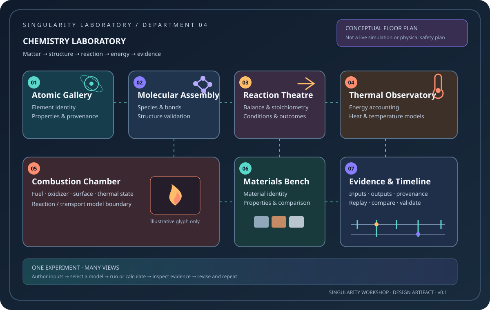

# Chemistry Laboratory — Department Floor

**Status:** preforge Experience design; no claim of a deployed interactive floor or validated chemistry solver.

**A laboratory where matter tells its story.** Enter through the atomic gallery, assemble molecules, configure a reaction, then watch the same experiment connect chemistry to heat, materials, and combustion—while the evidence panel tells you what was measured, calculated, or merely illustrated.

The seven rooms also have a renderer-independent [structured room catalog](contracts/rooms.json), checked against its [JSON Schema](contracts/chemistry-laboratory-rooms.schema.json). This is authored Experience content, not yet a runtime-loaded floor or an executable chemistry model.

## The floor

- **01 · Atomic Gallery** — inspect element identity, atomic number, symbol, and atomic weight; compare known properties only when their provenance and units are available.
- **02 · Molecular Assembly** — arrange atoms into a candidate molecular structure. A structure is not automatically a valid molecule: valence, charge, bond order, geometry, and species identity must be validated by the chemistry model.
- **03 · Reaction Theatre** — choose reactants, propose a reaction, balance the equation, and inspect stoichiometry and conservation. The theatre must distinguish a balanced equation from a reaction known to occur under the selected conditions.
- **04 · Thermal Observatory** — follow energy bookkeeping between chemical, thermal, and other explicitly modeled reservoirs. No temperature or heat-release curve is shown as computed until the underlying model supplies it.
- **05 · Combustion Chamber** — explore the coupled roles of fuel, oxidizer, surface area, thermal energy, and transport. This is a model-driven research bay, not a hazardous real-world procedure or a claim that flame dynamics already exist.
- **06 · Materials Bench** — compare how candidate materials and their defined properties affect a chosen experiment. Do not infer a complete material model from an element record alone.
- **07 · Evidence & Timeline** — pause, step, replay, compare revisions, inspect units, assumptions, conservation checks, and model provenance.

## The first guided investigation

**Question:** Where does the energy go when a modeled reaction occurs?

1. Select a reaction from the verified catalog—or begin with a clearly labelled hypothetical reaction.
2. Inspect the balanced equation and the source of every species/property definition.
3. Choose initial conditions and identify which variables are fixed.
4. Run the selected model only if the required capability is available.
5. Compare reactant/product accounting, energy transfer, and any modeled temperature or transport fields.
6. Repeat with one changed variable and compare runs.
7. Export the experiment definition and evidence, not just a screenshot.

A visitor can enter at the atomic gallery and leave through the evidence wall without reading a textbook first. Deeper theory remains one click away.

## The coyote moment

Chemistry should be playful enough to let the player make a mess. The [Safe Mishaps contract](design/SAFE_MISHAPS.md) specifies the comic puff-in-the-face moment: a pop, smoke, soot, frazzled hair, a dazed blink, then automatic recovery—no death, lasting injury, or lost experiment.

The gag is a presentation event, not a fabricated scientific result. Until a validated model reports a relevant outcome, the experience labels it as a scripted comic mishap or an unknown outcome. Atom/charge accounting alone never predicts an explosion.

## Experience boundary

- **Experience owns:** the floor plan, room/department identity, visitor journey, experiment definitions, model selection, provenance display, and links between views.
- **MicroBundles own:** independently addressable element/species/reaction/property/experiment capabilities once their contracts are verified.
- **Physics owns:** deterministic physical primitives and validated coupled models. It does not own this department's presentation.
- **FSM_COS owns:** composition and capability arbitration; the Experience does not run its own global scheduler.
- **Visualize / Renderer own:** visual encoding of authoritative values. They must not invent simulation output.
- **GUI / manifestation owns:** selection, camera, interaction, accessible controls, and browser/desktop/VR-specific presentation.
- **Mutable experiment projects** are separate from immutable published MicroBundle artifacts.

The initial element contract in `src/Elements` provides an atomic identity seed (atomic number, symbol, name, atomic weight) and an Elements MicroBundle. That is useful groundwork, not a complete periodic table, species database, reaction network, or chemical solver. The Physics repository's combustion cell is likewise a state contract, not reaction kinetics or a validated flame solver.

## Truthful maturity labels

Use these labels on every room and visual:

- **Concept** — proposed room, workflow, or explanatory diagram.
- **Authored data** — user can edit definitions, but no chemistry result is implied.
- **Calculated** — values follow a named equation/model with units and input provenance.
- **Simulated** — a real, identified solver produced the result.
- **Validated** — repeatable tests check the advertised behavior and relevant conservation/error bounds.

Never let color, animation, or a glowing molecule imply a result that the selected model did not calculate.

## First implementation slice

1. Preserve stable Experience key `chemistry-laboratory`; reserve a numeric Experience ID before publication.
2. Verify the actual MicroBundleDomain contracts and assign bundle IDs only after checking the existing registry.
3. Expand the atomic identity seed into validated element data with provenance and tests.
4. Add distinct species and bond/structure contracts before reaction definitions.
5. Add reaction balancing and stoichiometric accounting as independently testable mathematics.
6. Introduce thermochemical properties and reaction kinetics only with units, assumptions, and reference cases.
7. Couple the reaction model to Physics thermal/combustion state through an explicit adapter.
8. Produce a run-backed living diagram from reproducible experiment output.
9. Integrate the Experience into the WebPage discovery/catalog surface after the authored contract and manifestation path are verified.

## Living image

The floor plan below is a **conceptual design image**, not a running floor simulation. The next milestone is an interactive view bound to the same authoritative experiment state as the equations, timeline, and evidence report.

See [the Physics branch atlas](https://github.com/TrentBest/TheSingularityWorkshop.Physics/blob/development/docs/PHYSICS_BRANCH_ATLAS.md) for the domain gap map and [Build to Illuminate](../../docs/BUILD_TO_ILLUMINATE.md) for the implementation principle.

## First executable chemistry capability

The Experience now has a separate .NET chemistry core at [src/Chemistry](../../src/Chemistry/TheSingularityWorkshop.Experiences.Chemistry.csproj). Its first contract models a species with explicit elemental counts and charge, a proposed reaction with positive integer coefficients, and a deterministic conservation audit. The [tests](../../tests/Chemistry.Tests/ReactionBalanceAnalyzerTests.cs) cover balanced water formation, an unbalanced equation, charge conservation, invalid inputs, and defensive copying.

**Scope boundary:** this computes atom and charge accounting only. It does not auto-balance equations, predict reaction feasibility, calculate energy, model kinetics, or claim a validated simulation. The room catalog remains authored Experience content until a runtime loader and registered capability path are implemented.
