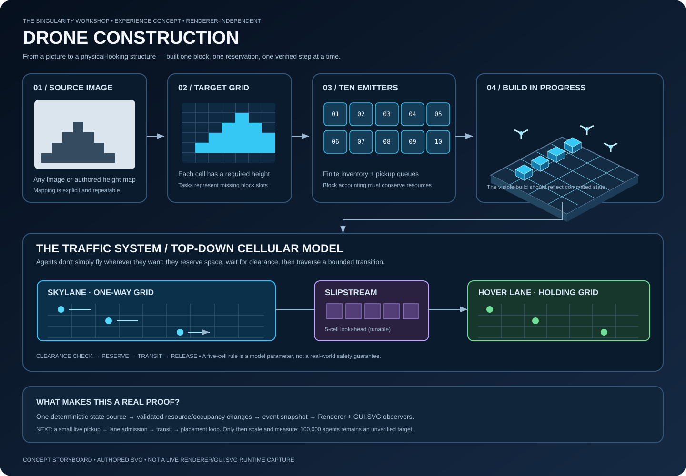
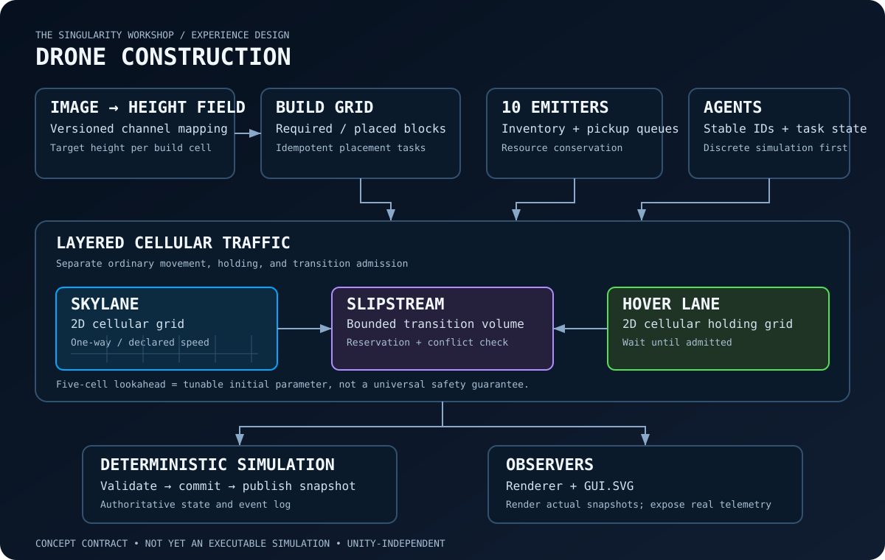

# Drone Construction

**Status:** a small deterministic discrete simulation loop and a separately tested slipstream admission primitive are implemented on `development`; lane-transition integration into the simulation lifecycle, live GUI.SVG observation, and scale/performance evidence remain incomplete.

Drone Construction is a benign large-scale multi-agent construction experience. A source image is converted into a discrete target structure; simulated quadcopters collect blocks from ten emitters and place them into the target. The showcase goal is to demonstrate how a large population can coordinate through explicit state, resource, and traffic contracts.

The original Unity implementation was lost with its former machine. This folder is the canonical reconstruction brief. The new implementation must be renderer-independent and must not require Unity.

*This storyboard is an authored concept diagram, not yet a live GUI.SVG rendering of simulation state.*

## The idea in a minute

1. **Image → height field.** Each image sample becomes a target height at a grid location. The initial contract must specify whether channels are interpreted independently or combined into one height; this is a configurable mapping, not an implicit assumption.
2. **Target → block tasks.** The target structure is represented as discrete cells and explicit placement tasks.
3. **Emitters → resource supply.** Ten block emitters expose available inventory and pickup capacity.
4. **Traffic → predictable movement.** Skylanes are 2D cellular grids with one-way movement. Hover lanes are 2D cellular grids for waiting and admission. Slipstreams are compact transition volumes where conflict checks are required.
5. **Agents → observable state.** Each simulated agent has a stable identity, current task, location, movement mode, and lifecycle state.
6. **Renderer + living diagrams.** Renderer presents the world; GUI.SVG documents and visualizes contracts, state transitions, and measured telemetry.

## Traffic vocabulary

- **Skylane:** a 2D cellular grid. A lane has a declared direction, speed policy, elevation, and cell-occupancy contract. The first model assumes same-direction movement within a lane.
- **Hover lane:** a 2D cellular grid for agents that are stationary or awaiting admission to a transition. It is not an unbounded parking area: capacity and occupancy must be explicit.
- **Slipstream:** a small, bounded transition volume between a hover lane and a skylane. It is a coordination boundary, not a free-form shortcut. Entry requires a reservation/clearance decision and a conflict check.
- **Transition lookahead:** the remembered prototype used a five-cell lookahead. Treat five cells as an initial tunable simulation parameter, not a universal safe distance. Its sufficiency depends on cell units, acceleration model, tick duration, occupancy semantics, and the length of the transition.
- **Block emitter:** one of ten resource sources with inventory, pickup slots, and queue state.
- **Build cell:** a discrete target location whose required height and placed-block count can be compared.
- **Agent:** a simulated construction worker. Its behavior is deterministic when the simulation seed and inputs are fixed.

## MicroBundle boundaries

The initial catalog is defined in [MICROBUNDLE_BOUNDARIES.md](design/MICROBUNDLE_BOUNDARIES.md). The required entry/traversal/exit semantics and invariants are specified in [LANE_TRANSITION_LIFECYCLE.md](design/LANE_TRANSITION_LIFECYCLE.md); this is a design contract, not an assertion that lane integration is complete. `QualifiedGridLocation` now identifies a space kind, stable space ID, and local cell. `ConstructionSimulation` exposes `SpaceId` and `GetAgentLocation(agentId)` so callers can query an agent's current qualified simulation-grid location. Agent IDs are indexed in a dictionary for average constant-time lookup rather than scanning the sorted agent array. `TrafficCellGrid.TryGetAgentCell` exposes the reverse occupancy index so transition tests and diagnostics can verify an agent's authoritative cell after movement, cross-grid transfer, and release; tests cover those index updates as well as qualified simulation locations, unknown IDs, and invalid space IDs. Agent snapshots now expose both the legacy local `GridCell` and a qualified `Location`; the qualified value is currently always the simulation-grid space because lane transitions are not yet integrated. Nine provider classes currently expose tested factories for height fields, build grids, resource emitters, traffic cells, skylanes, hover lanes, slipstreams, agent lifecycle, and deterministic task assignment. The initial single-threaded simulation loop now assigns tasks, picks up finite-inventory blocks, moves agents one cell at a time under exclusive occupancy, places blocks, and emits immutable snapshots. The standalone `Slipstream.TryAdmit` primitive checks a clear destination/lookahead, transfers occupancy between grids, retains its single-agent reservation until explicitly released, and rolls back that reservation if transfer fails or throws. `SlipstreamLifecycle` now coordinates a dedicated transition grid: it reserves downstream capacity before entry, transfers source occupancy into the transition grid, advances only one orthogonal cell at a time, retains occupancy/reservation when exit is blocked, and releases transition capacity only after the exit transfer succeeds; each reservation is bound to its admitted destination grid and cell, and exits to any other target are rejected. Regression tests cover lifecycle entry, traversal blockage/retry, exit-target binding, blocked exit, failed-entry rollback, plus duplicate admission, same-grid rejection, invalid source coordinates, blocked destinations, immutable reservations, owner-only release, duplicate identity, and reservation release after failed transfers. Skylane policy tests cover directional speed limits and reject reverse, diagonal, already-reached, and out-of-bounds targets. `ConstructionSimulation` can register exactly one `SlipstreamLifecycle` owner per registered transition-space identity and provides entry/advance/exit overloads that resolve that owner; compatibility overloads reject a substitute coordinator once an owner is registered. A failed exit preserves the agent's qualified transition location and reservation so the same owner can retry after the destination clears. Simulation-level tests cover owner registration/substitution and blocked-exit retry. These APIs are not yet wired into `ConstructionSimulation.Step()`, and the lookahead check is an admission-time check rather than a persistent reservation of every lookahead cell. Skylane direction, hover-lane admission, event replay/digests, and renderer observers are not yet integrated into the loop.

## Truthful milestones

- **M0 — authored contract:** this design, vocabulary, bundle boundaries, and architecture diagram.
- **M1 — deterministic discrete model:** image-height mapping, target cells, stable agent IDs, finite emitter inventory, exclusive cell occupancy, one-cell movement, placement, and immutable snapshots; no 3D physics claim.
- **M2 — lane transition proof:** tested skylane/hover-lane/slipstream admission and conflict invariants in a small deterministic grid.
- **M3 — rendered vertical slice:** the pickup → cell movement → placement loop exists for a small discrete grid. Renderer/GUI.SVG must next consume the actual snapshots; the current vision board remains conceptual.
- **M4 — scale evidence:** repeatable population sweeps, correctness checks, throughput, memory, allocation, and frame-time reports. 100,000 agents remains a target until measured.
- **M5 — optional physical model:** add a tested physics provider only when its API, units, stepping, and collision evidence are explicit.

## Non-goals for the first slice

- No Unity dependency.
- No claim that the original 100,000-agent performance has been recovered.
- No fake motion that is merely a prerecorded animation while telemetry claims a live simulation.
- No assumption that the five-cell transition rule is safe for every speed or timestep.
- No coupling of domain simulation to a particular renderer.

**North star:** show that many simple agents can build a shared target through explicit, testable rules—and make the actual rules visible.
