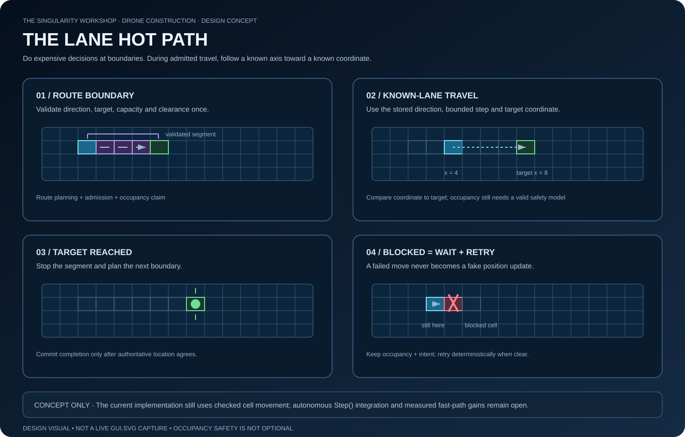

# Drone Construction — Autonomous Lane Execution Contract

**Status:** partial operational implementation. Registered skylane routes advance from `ConstructionSimulation.Step()`; pending transition intents are admitted/retried there in stable agent-ID order. Intents may now declare an explicit orthogonal transition path, which the simulation advances one cell per tick and retries across blocked intermediate cells or exits. CI verification of this new path is pending; automatic downstream target selection and end-to-end itinerary execution remain incomplete.

## Goal

Make lane travel progress from the authoritative `ConstructionSimulation.Step()` loop. Callers should express a qualified destination and route intent; they should not have to manually call lane movement once per tick. Preserve the useful computational distinction:

- **At route boundaries:** validate topology, direction, target alignment, capacity, and downstream clearance.
- **During admitted travel:** advance the known lane coordinate using integer arithmetic and compare it with the precomputed target.
- **At transitions:** perform an explicit occupancy transfer; if it fails, retain the current occupancy and reservation so a later tick can retry.

The optimization target is less repeated route discovery and policy work, not the removal of traffic correctness.



*Concept illustration only: skylane movement and pending transition admission are tick-driven; slipstream traversal, exit retry, and complete itinerary execution remain open.*

## What exists today

- `LaneTransitionIntent` is immutable intent data containing qualified source, slipstream entry, qualified destination, and lookahead cells. An optional explicit path includes the entry and exit cells; construction validates that it starts at the entry, has unique cells, and uses orthogonally adjacent steps. The intent itself does not reserve or move anything.
- `LaneTransitionAdmissionPolicy` validates the committed source and holds an intent while admission is blocked; a successful admission consumes it.
- `SlipstreamLifecycle` reserves the destination and lookahead, transfers the agent into the transition grid, advances one orthogonal cell per call, and transfers into the exact reserved destination. A failed exit preserves transition occupancy and the reservation.
- `ConstructionSimulation.TryAdvanceSkylane` computes the next lane position, checks every traversed cell, then moves atomically.
- `TryRegisterSkylane` registers the lane's occupancy grid as a qualified traffic space. `TrySetSkylaneDestination` assigns a direction-valid destination to an agent already occupying that lane.
- `ConstructionSimulation.Step()` advances registered skylane routes in stable agent-ID order. Each tick attempts one safe lane move (bounded by the lane movement policy); a blocked move leaves the agent in place and retains its destination for retry. Reaching the destination clears the route.
- `ConstructionSimulation.Step()` advances previously admitted explicit transition paths in stable agent-ID order, then attempts pending admissions. A successful admission starts at the path's entry and cannot move again until a later tick. Blocked intermediate cells and exits preserve the active path, occupancy, and reservation for retry; a successful exit transfers into the exact qualified destination.
- Intents without an explicit path preserve the existing manual lifecycle behavior after admission. The active path ends at its declared destination; a further skylane target is not inferred and must be assigned explicitly after exit.

These primitives are useful, but they are not yet a complete autonomous itinerary.

## Required authoritative state

An autonomous lane itinerary needs a single simulation-owned record per moving agent. At minimum, it must identify:

- The agent ID and its exact committed `QualifiedGridLocation`.
- The current phase: waiting for admission, traversing a transition, traversing a lane, waiting to exit, or complete/cancelled.
- The active lane/transition resource identity.
- The exact destination and the next route boundary.
- The admitted movement/capacity claim and the configuration version that justified it.
- Any blocked/retry reason that affects the next deterministic decision.

The committed location catalog and each occupancy grid remain authoritative for where an agent actually is. An itinerary is intent and progress metadata; it must never be a competing source of occupancy truth. `ConstructionAgent.Position` must be synchronized only after the corresponding occupancy move/transfer commits.

## State machine

```text
Ready at qualified source
       |
       v
Intent submitted ---- invalid source/config ----> reject without mutation
       |
       v
Waiting for admission ---- capacity/clearance blocked ----> retain intent; retry
       |
       | admission + occupancy transfer commits
       v
Inside transition ---- intermediate cell blocked ----> retain current cell; retry
       |
       | exact reserved destination transfer commits
       v
On lane with admitted target/segment
       |
       | each tick: bounded directional coordinate advance
       | blocked/unreserved next cell -> remain in place; report wait
       v
At route boundary
       |
       +---- next segment available ----> admit next segment and continue
       |
       +---- transition required -----> submit/execute explicit transition
       |
       +---- destination reached -----> complete itinerary
```

A failed operation is not a phase transition. A successful occupancy transfer is the commit point for a space change. Failed admission retains the pending intent; failed transition exit retains the agent in the transition and keeps the reservation; a blocked lane move retains the previous cell and target.

## Occupancy and lookahead invariants

1. An agent occupies at most one qualified grid cell at a time.
2. A grid's forward and reverse occupancy indexes agree: the cell names the agent, and the agent index names that cell.
3. An agent's committed qualified location and local position agree after every committed operation.
4. No movement may enter an occupied cell or pass through a cell whose safety is not covered by an explicit, valid admission/reservation rule.
5. A reservation belongs to one agent, one resource, and one exact destination/segment configuration. It cannot authorize a different destination.
6. A failed admission, move, or exit does not silently release the agent's current occupancy.
7. Reservations are released only after the protected transfer commits, or after an explicit cancellation that proves no protected occupancy remains.
8. Agents are processed in stable identity order, or a separately specified deterministic arbitration policy decides conflicts. Enumeration order must not accidentally decide priority.
9. A retry must be idempotent: repeating the same blocked request cannot duplicate reservations, occupancy, or progress.
10. No observer, renderer, or LOD decision can change admission, occupancy, or itinerary state.

## The coordinate-only hot path: preconditions

The target-coordinate comparison is a cheap termination test, not by itself a collision-prevention mechanism. Before reducing per-cell checks, the implementation must choose and test one explicit safety model:

- **Per-step occupancy:** calculate the next bounded coordinate and use the grid's atomic move operation. This is the safe baseline and may still eliminate repeated route solving.
- **Reserved segment:** atomically reserve the complete bounded segment (including conflict ownership), and require every competing entrant to honor those reservations. While the claim remains valid, traversal can use the prevalidated axis and target. Release cells behind the agent according to a tested rule, and retain the claim if progress stalls.
- **Exclusive lane slot:** model a lane as fixed exclusive slots with explicit following-distance/spacing rules. A slot claim must prove that a drone cannot overlap a follower or conflicting crossing. This is a different traffic model and needs its own tests.

Do not adopt the reserved-segment or exclusive-slot fast path until reservation ownership, expiry/release, cancellation, and competing-agent behavior are implemented. Existing slipstream destination/lookahead reservations do not automatically prove that every future lane cell is reserved.

## Deterministic tick algorithm

For each committed tick:

1. Validate itinerary/location consistency for all agents the tick executor may advance before mutating authoritative state.
2. Visit agents in stable `AgentId` order (or use a documented deterministic arbitration pass).
3. For each agent, perform at most the transition permitted by its current phase.
4. Reuse its prevalidated direction, target, and movement budget while the same lane-segment configuration remains active.
5. Attempt the occupancy operation. If it fails, keep location and progress unchanged and record a deterministic blocked outcome.
6. Commit itinerary phase/progress only after the occupancy operation succeeds.
7. Produce the snapshot from the resulting coherent state, then advance the committed tick identifier.

If any whole-tick preflight is intended to guarantee no partial tick, it must cover all state that the tick can mutate—not just primary-grid agents. Otherwise define and test the exact per-agent transaction boundary and fault behavior.

## Required tests before calling the loop autonomous

### State and location
- Agent in every external space is not accidentally advanced by the primary-grid task loop.
- `Position`, qualified location, grid forward index, and reverse index agree after each successful move/transfer.
- Wrong lane ID, grid instance, target axis, or direction rejects without mutation.
- Lane completion and transition completion occur once, not repeatedly.

### Admission, blockage, and retry
- Occupied lookahead blocks admission and preserves the pending intent.
- An unavailable destination blocks exit while preserving transition occupancy and reservation.
- A blocked lane step preserves the last valid cell and retries deterministically.
- Repeated blocked requests do not leak or duplicate reservations.
- Cancellation cannot release a reservation while the agent still depends on it.

### Conflict and fairness
- Two agents requesting the same cell/segment cannot both be admitted.
- Opposing-direction or crossing routes cannot claim conflicting space without an explicit policy.
- A moving leader and a waiting follower preserve minimum separation.
- Stable inputs produce stable winners, movement outcomes, and snapshots.
- Starvation is measured or bounded by a documented arbitration policy.

### Hot-path proof
- Compare the safe per-step baseline with the reserved-segment implementation using identical seeded workloads.
- Verify the final authoritative occupancy and route result are identical.
- Record agent count, ticks, grid/lane dimensions, seed, build revision, elapsed time, allocation count, blocked attempts, and reservation counts.
- Benchmark route-planning work separately from per-tick movement and observer work.
- Do not claim a performance improvement from arithmetic intuition alone; publish the measured baseline and result.

## Implementation sequence

1. Introduce the simulation-owned itinerary state and validate its relationship to the committed location catalog.
2. Make `Step()` advance registered skylane destinations, retry pending transition admission, and traverse an explicitly declared slipstream path with retry-safe exits (implementation added; CI pending); keep external-space agents out of the primary-grid placement scheduler.
3. Preserve the existing safe occupancy path and add deterministic blocked/retry outcomes (implemented for registered skylane destinations).
4. Add transition and lane lifecycle tests, including two-agent contention and cancellation.
5. Add a repeatable small-run replay/invariant harness.
6. Benchmark the safe baseline; only then implement a reserved-segment or slot fast path if measurements justify it.
7. Connect the committed snapshot to the live Renderer/GUI.SVG adapter after the model is authoritative.

## Exit criteria

Autonomous lane execution is complete only when the lifecycle advances from a submitted intent through admission, transition, lane movement, and route completion through `Step()`, with deterministic conflict handling, occupancy/retry invariants, and tests for blocked and competing agents. The implementation now includes explicit-path transition traversal and blocked intermediate/exit retry in Step(); these new behaviors require green CI before being treated as verified. Full itinerary completion still requires an explicit downstream skylane target and broader contention/fairness tests. The coordinate-only optimization is a separate milestone and requires measured evidence.
