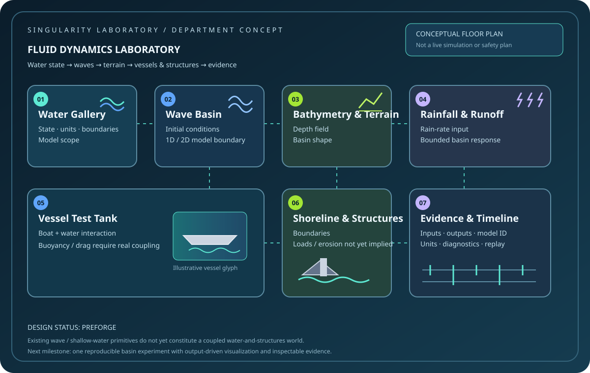

# Fluid Dynamics Laboratory — Preforge Experience

**Status:** authored department concept grounded in existing Physics primitives; not yet a connected, host-runnable water simulation.

The Fluid Dynamics Laboratory makes water legible as a changing physical world: waves travel, rainfall fills a basin, bathymetry redirects flow, and eventually boats and structures respond to the water rather than floating as decorative props.

It belongs inside the **Singularity Laboratory** and complements Chemistry's focus on matter, species, reactions, and energy. This department focuses on fluid state, transport, boundaries, and interactions with solid bodies.

## Visitor journey

1. **Water Gallery** — inspect basin state, units, boundaries, and what the selected model actually represents.
2. **Wave Basin** — change a bounded wave scenario and compare the supported 1D wave reference or 2D shallow-water models.
3. **Bathymetry & Terrain** — reshape a basin and see how the configured depth field participates in the model.
4. **Rainfall & Runoff** — change a rainfall input and inspect its contribution to a modeled water state.
5. **Vessel Test Tank** — introduce a boat-shaped test body. Until buoyancy, drag, and fluid/body force exchange are implemented and validated, its motion must be labelled as authored preview rather than simulated response.
6. **Shoreline & Structures** — explore a dam, seawall, bridge pier, or building boundary. Do not claim structural loading, erosion, or damage unless a connected model calculates it.
7. **Evidence & Timeline** — compare inputs, revisions, model identity, outputs, units, and conservation diagnostics.

## Existing Physics foundation

The Physics repository already includes 1D wave and 2D shallow-water/bathymetric basin models plus a rainfall-rate field. Those are useful starting capabilities, not proof of a complete hydrodynamics world. The Physics gap register explicitly identifies solid/fluid coupling, boat/body motion, 3D flow, and validated cross-domain mass/energy exchange as open gaps.

- [Physics domain map](https://github.com/TrentBest/TheSingularityWorkshop.Physics/blob/development/docs/PHYSICS_DOMAIN_MAP.md)
- [Physics gap register](https://github.com/TrentBest/TheSingularityWorkshop.Physics/blob/development/docs/PHYSICS_GAP_REGISTER.md)
- [Physics source tree](https://github.com/TrentBest/TheSingularityWorkshop.Physics/tree/development/Physics/Hydrodynamics)

## Floor plan

This is a **conceptual floor plan**, not a live simulation, a registered spatial Place catalog, or a physical flood-safety plan.

## Authority and evidence

- **Experience:** room identity, visitor journey, authored scenes, and exhibit progression.
- **Physics:** authoritative model state, stepping, water levels, wave observations, contact/force results, and conservation diagnostics where implemented.
- **Host / Visualize:** controls, camera, appearance, and effects; presentation cannot invent water state or claim physical force.
- **FSM_COS:** composes compatible capabilities; it is not the simulation loop.

Every exhibit must label its maturity honestly: concept, authored preview, calculated, simulated, or validated. A visually convincing wave is not evidence that the solver computed it.

## First useful implementation slice

1. Connect a small 2D shallow-water basin through the real Physics API.
2. Expose initial water state, basin geometry/depth, boundary conditions, and time-step settings that the model actually supports.
3. Show a water-level field and a run record derived from the model output.
4. Add repeatability and conservation/validity checks appropriate to the solver.
5. Only then introduce a floating-body experiment, with buoyancy and fluid/body exchange as explicit prerequisites.

The first release should prefer one inspectable, reproducible basin over a large animated ocean whose causal behavior cannot be verified.

---

   
  <strong>The Singularity Workshop</strong> 
  <em>If a picture is worth a thousand words, what is a living picture worth?</em> 
  <a href="https://github.com/TrentBest">GitHub</a> · <a href="https://www.patreon.com/TheSingularityWorkshop">Support the Workshop</a>

