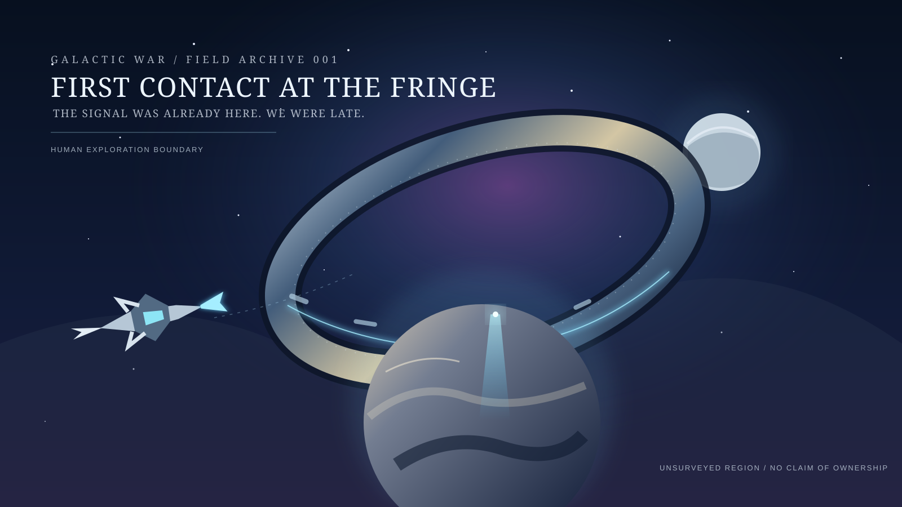

# Galactic War — Game Design Foundation

**Status:** candidate game design. This is a working design record, not a claim that the described systems are implemented.  
**Scope:** single-player discovery campaign, ambient world events, ancient-site exploration, narrative authoring, and the first visual direction.

## The promise

The galaxy is not waiting for the player.

Civilizations continue to live, argue, trade, explore, fight, remember, and change whether the player is present or not. The player begins near the edge of a familiar human sphere and gradually discovers that the known map is only a thin, politically shaped account of a much larger reality.

The first major contact event is already underway when the game begins. It is not triggered by the player's arrival, and the player is not selected by prophecy to cause it. The player hears about it indirectly, through the ordinary media and conversations of a lived-in world. It happens at the very distant outskirts of human space—far enough away that most people will never go there, but close enough to become a persistent subject of public fascination, argument, fear, opportunism, and speculation.

The campaign's deeper invitation is: **go out there, find out what is actually happening, and discover what else has been waiting in the dark.**

## 1. Player experience and opening structure

### 1.1 Begin with ordinary life

The opening should establish a place before it establishes a plot. The player is in a station, settlement, ship, academy, or other inhabited location. Screens are not merely UI panels: they are televisions, public displays, news walls, shipboard terminals, and local information channels that belong to the world.

The first-contact story appears as background media:

- a station television carries a breaking report while people continue their day;
- a public ticker repeats a distant observatory's announcement;
- a lounge conversation argues about whether the signal is artificial;
- a dockworker says the shipping lanes are already changing;
- a government spokesperson insists there is no immediate danger;
- an independent journalist points out that the official account omits key evidence;
- a later broadcast corrects an earlier claim, revealing that the story is moving without the player.

The player may ignore all of it. The world should continue.

### 1.2 The event is at the edge

The first-contact site is far beyond the comfortable center of human traffic: an outer survey region, marginal colony route, or poorly charted frontier. It is distant in practical terms, not merely described as distant in dialogue. Travel time, fuel, range, permissions, local infrastructure, and uncertainty should make the frontier feel remote.

The event's first public description is incomplete. Something has been detected; the source, intent, and even the meaning of the evidence remain disputed. Different outlets and factions frame the same evidence differently. Some are careful. Some sensationalize. Some are selling something.

### 1.3 Let the player become curious

The player can encounter the story in several low-pressure ways:

1. **Ambient exposure:** see or hear a report without interacting.
2. **Attention:** stop to watch, ask an NPC, inspect a public terminal, or read a report.
3. **Context:** compare accounts, identify omissions, notice a correction, or discover a local consequence.
4. **Commitment:** accept a job, investigate a lead, prepare a vessel, or choose to remain elsewhere.
5. **Independent discovery:** arrive at the frontier and find that the actual situation differs from the public story.

No mandatory exposition dump should explain the entire mystery. Repeated exposure should add fragments and contradictions. The player assembles a model.

## 2. Background media as a world system

Televisions, radio, public displays, ship feeds, and personal terminals should be authored manifestations of an underlying information world.

A report is not simply a line of dialogue. It has:
- a source and editorial perspective;
- a publication time and an in-world event time;
- evidence available to the source;
- claims, uncertainty, and omissions;
- an intended audience and distribution reach;
- corrections, updates, and later historical status;
- relationships to the event or events it describes.

A station in the human core may receive a polished government bulletin. A frontier port may receive delayed, compressed, or locally edited reports. A private ship may carry old recordings. A faction-controlled station may suppress a story or present an alternative interpretation.

**The broadcast is a character's account of an event, not the event itself.**

### 2.1 Diegetic placement

The same information system can appear through different world objects:

| Medium | Typical use |
|---|---|
| Public television | Breaking news, interviews, official statements, documentary segments |
| Station ticker | Short updates, alerts, market and travel disruptions |
| Lounge or bar display | Background coverage that makes a place feel inhabited |
| Shipboard feed | Long-form reports, mission briefings, archived recordings |
| Personal terminal | Searchable sources, saved leads, original evidence |
| NPC conversation | Local interpretation, rumor, memory, disagreement |

Presentation should depend on location, time, source access, and what the player has already learned. Do not make every screen repeat the same omniscient summary.

### 2.2 A small but meaningful first-contact news arc

The following is a candidate sequence, not fixed canon:

1. **Unusual signal:** a remote observatory reports a structured anomaly. The public is unsure whether it is natural, artificial, or instrument error.
2. **Independent confirmation:** a second instrument confirms the pattern, but not its origin.
3. **The argument begins:** public analysts disagree about whether the pattern is a message, a beacon, or an automated process.
4. **A human consequence:** a frontier route is temporarily restricted; freight, insurance, and local politics react before anyone understands the source.
5. **A missing interval:** a probe or expedition fails to report on schedule. Competing accounts emerge.
6. **The correction:** an earlier confident report is publicly revised. The source was not where the first analysis placed it.
7. **A new image:** a distant instrument captures a physical structure or phenomenon that does not fit the original explanation.
8. **The invitation:** a credible lead becomes available to the player, but so do rumors, bad maps, opportunists, and dangerous assumptions.

The arc must remain capable of changing in response to player discoveries. The sequence is a pacing scaffold, not a pre-recorded cutscene chain.

## 3. The world continues: events, discovery, and consequence

Galactic War should contain events that can be discovered by the player or by other actors. The player's absence must not freeze the galaxy.

An event can be:
- **authored:** deliberately composed by a designer or StoryBuilder;
- **simulated:** produced by interacting world systems;
- **observed:** recorded by an actor, sensor, or institution;
- **reported:** communicated through a source with a perspective;
- **rumored:** repeated without sufficient verification;
- **discovered:** encountered by an actor who did not previously know it;
- **resolved:** brought to a consequential state, which may remain disputed.

These are not interchangeable states. A rumor can refer to a real event, a mistaken interpretation, or deliberate deception. A discovered object can remain unidentified. A report can be wrong without being malicious.

### 3.1 Event independence

Every consequential event should have an existence and history independent of whether the player sees it.

Examples:
- a rival expedition reaches an ancient site first;
- a station loses contact with a remote mining habitat;
- a faction quietly removes artifacts from a ruin;
- a dormant machine begins a process after a long environmental change;
- a migration route shifts and disrupts a trade corridor;
- a salvage crew finds evidence that changes a political claim;
- an enemy discovers a weapon, archive, or route before the player does.

The player can intervene, observe, misunderstand, exploit, help, or miss the event. The world should record the difference.

### 3.2 Discovery is an information transition

A discovery should record more than a quest-completion flag. At minimum, a future domain model should be able to express:

- the subject or phenomenon discovered;
- the discovering actor or group;
- the time and location of discovery;
- the evidence and method;
- the discoverer's confidence and interpretation;
- what was already known by other actors;
- who was informed, who was not, and when;
- whether the discovery was shared, concealed, sold, disputed, or falsified;
- what changed as a result.

This supports competing discoveries. A rival may discover a site, misunderstand it, and publish a misleading claim. The player may later recover primary evidence. Neither account should erase the historical fact that the rival got there first.

### 3.3 Multi-scale simulation

Do not simulate every citizen and ship at maximum fidelity at all times. Preserve consequential truth and use appropriate detail:

- **Authoritative:** persistent identity, ownership, decisions, event history, discoveries, commitments, and lasting consequences.
- **Bounded simulation:** detailed local activity when nearby or consequential.
- **Ambient:** background activity summarized at a coarser level when no detailed simulation is needed.
- **Authored:** deliberately composed scenes, broadcasts, and character moments, clearly connected to their world context.

A station television can show a designed broadcast while the underlying news event is represented by a structured record. The broadcast's script does not become the authoritative world state.

## 4. Space archaeology: the adventure beneath the adventure

The ancient-alien-discovery strand should become a signature adventure pattern. It is not just a collectible hunt with a different texture.

A site should feel as if something happened there, and as if it may still matter. Its architecture, materials, damage, orientation, environmental interactions, inscriptions, and relationship to nearby structures are evidence. The visitor is an investigator, not simply a person opening containers.

### 4.1 The archaeological loop

**Notice → Reach → Secure → Observe → Hypothesize → Test → Interpret → Decide → Preserve or Disturb**

- **Notice:** encounter a signal, anomaly, rumor, fragment, map discrepancy, or strange object.
- **Reach:** plan a route, acquire permissions, prepare equipment, and survive the journey.
- **Secure:** understand immediate hazards and stabilize the site without assuming it is safe.
- **Observe:** document the environment before changing it.
- **Hypothesize:** form competing explanations from evidence.
- **Test:** use instruments, physical interaction, translation, environmental changes, or controlled experiments.
- **Interpret:** distinguish what the evidence supports from what remains speculation.
- **Decide:** preserve, extract, share, conceal, restore, activate, or leave.
- **Preserve or disturb:** record the consequences. Some actions may be irreversible.

### 4.2 What can be discovered?

- **Artifacts:** tools, personal objects, devices, ceremonial objects, fragments, or unknown technologies.
- **Structures:** ruins, stations, gates, habitats, observatories, vaults, or immense engineered landscapes.
- **Archives:** records, memory substrates, maps, sensory recordings, or living repositories.
- **Processes:** machines still operating, dormant systems, automated defenses, ecological cycles, or unfinished work.
- **Evidence of life:** traces of inhabitants, migration, disease, symbiosis, adaptation, or extinction.
- **Evidence of absence:** deliberate erasure, abandoned spaces, missing components, or a site designed to conceal that it ever existed.
- **Relationships:** proof that two civilizations traded, fought, cooperated, misunderstood, or shared a history that current factions deny.

An ancient object is not automatically a weapon. Its most consequential property may be a memory, a treaty, a biological dependency, a navigational relationship, or the ability to communicate with something that is not conventionally alive.

### 4.3 Space Indiana Jones—without reducing the world to a trope

We should absolutely have daring expeditions, rival treasure hunters, impossible ruins, traps, collapsing structures, narrow escapes, strange mechanisms, and discoveries that change the stakes. The tone can be adventurous and occasionally playful.

But the world should give sites histories and inhabitants. A mechanism may be a safety system, not a trap. A sealed chamber may be a quarantine boundary. A relic may be someone's remains, a protected archive, or an active part of an ecosystem. The player can still take risks and have thrilling escapes; the design should make the meaning of those risks discoverable.

### 4.4 Rival discoverers

The player is not the only explorer:
- corporate expeditions may prioritize extraction;
- universities and independent researchers may prioritize evidence and preservation;
- governments may classify discoveries;
- religious or cultural groups may claim custodianship;
- smugglers may remove objects and falsify provenance;
- rival adventurers may compete, cooperate, deceive, or need rescue;
- nonhuman civilizations may regard the site as a home, ancestor, organ, or active machine.

A race to a site can create tension without making discovery a simple speed contest. Arriving first is not the same as understanding it.

## 5. Combat and other forms of adventure

Space battles belong in this universe, but combat should arise from the situation rather than being the only verb.

A discovery expedition might encounter:
- a rival ship that wants the same object;
- an automated defense system whose rules are not understood;
- a faction enforcing a claim;
- environmental hazards that make maneuvering dangerous;
- an enemy searching for a discovery the player has not yet recognized;
- a misunderstanding that can be resolved, escalated, or avoided.

Combat should be an embodied event with positioning, momentum, line of sight, ship condition, crew, preparation, and consequences. Retreat, negotiation, stealth, repair, rescue, and evidence-sharing remain valid choices where the situation supports them.

A battle can be spectacular and still have a purpose: protecting an evacuation, buying time for an investigation, preventing an artifact from leaving, escaping a site, or deciding who controls a route.

## 6. The first single-player campaign: candidate structure

The initial campaign should prove the world model through a small connected region, not pretend to simulate the entire galaxy.

### Act I — The ordinary world

The player inhabits a frontier-adjacent human location. Background media introduces the distant contact story. Local characters have their own concerns. The player learns movement, observation, basic equipment, and how to find work without being forced into the main mystery.

### Act II — A small discovery

A routine assignment reveals an anomaly, artifact, or historical inconsistency. The player learns to preserve evidence, compare accounts, and distinguish a lead from a fact. A rival or institution takes an interest.

### Act III — The wider pattern

The discovery connects to an older site or event. The player discovers that the first-contact news story is not the only extraordinary event in the region. The connection may be indirect; do not force every mystery into one ancient conspiracy.

### Act IV — The frontier

The player chooses whether to travel toward the first-contact region, pursue the archaeological lead, follow a rival, or take another opportunity. The world continues regardless. News, factions, and local conditions change as time passes.

### Act V — Consequence, not closure

The player makes a consequential choice about what to reveal, preserve, remove, activate, or leave alone. The result changes relationships and future opportunities. The first contact itself may remain unresolved. The player has entered a larger story, not completed the galaxy.

## 7. StoryBuilder: authoring the living world

StoryBuilder is a natural partner for Galactic War. Its purpose is not to replace the simulation or dictate every player action. It should help us compose, inspect, and maintain the material from which a living Experience is built.

The StoryBuilder README establishes two distinct but linked records:
- the **build record:** what is being built, why, how it behaves, and how it is verified;
- the **fictional record:** the world, history, relationships, events, and continuity.

Galactic War should use that separation rigorously.

### 7.1 What we should author in StoryBuilder

- world premise, canon, candidate ideas, and unresolved questions;
- civilizations, characters, factions, locations, and relationships;
- nested timelines and historical events;
- event seeds and causal prerequisites;
- broadcasts, interviews, rumors, corrections, and source perspectives;
- archaeological sites, evidence, hypotheses, and possible interpretations;
- campaign arcs, scenes, missions, branches, and consequences;
- dialogue and authored moments;
- provenance for every accepted fact and important revision.

### 7.2 StoryBuilder is not the runtime simulation

A StoryBuilder-authored event can define an event template, starting conditions, constraints, narrative beats, and possible outcomes. The runtime world determines whether and when the event occurs, which actors participate, what they know, and how the event resolves.

A campaign author may say that a rival expedition *may* reach a ruin before the player. That is not the same as asserting that the rival has already done so in every playthrough.

Keep at least these distinctions:
- **authored possibility:** a designed event or branch that could occur;
- **world occurrence:** the event actually happened in this campaign instance;
- **observation:** an actor recorded some evidence of it;
- **account:** an actor or institution described what it believes happened;
- **canon/history:** the accepted or preserved record, with provenance and any unresolved dispute.

### 7.3 Stable identity and continuity

StoryBuilder's existing direction includes stable-ID timeline events, passage anchors, chronology, and local project persistence. Those concepts are useful foundations for linking a broadcast passage to an event, a discovery to its evidence, and a campaign scene to the world history it changes.

We should not invent a parallel authoring model in Experiences. Instead:
1. define Galactic War's domain concepts and narrative contracts here;
2. identify the exact StoryBuilder capabilities that already exist;
3. record gaps before assuming they are implemented;
4. prototype a small authored event in StoryBuilder;
5. only then design the Experience/runtime bridge.

The first proof should be a single news event with multiple source accounts, a timeline, a correction, and one player-discoverable lead.

## 8. Workshop technology boundaries

- **Experiences** owns Galactic War's fictional meaning, game rules, campaign semantics, and composition.
- **StoryBuilder** is the authoring workbench for the linked build record and fictional record.
- **FSM_API** can represent persistent identities and state transitions for world entities and events.
- **FSM_COS** composes capabilities for observers, instruments, ships, sites, and actors.
- **FSM_Foundry** executes composed behavior; authoring a possible event is not executing it.
- **Physics** owns reusable physical models and mathematics. Experiences should not create a parallel physics library.
- **Economy** supplies shared economic vocabulary and simulation capabilities; Galactic War defines its civilization-specific policies and consequences.
- **GUI.Core** supplies reusable visual meaning and interaction structures.
- **Renderer** and **Visualization** are consumed as MicroBundles. They manifest views; they do not own authoritative world state.
- **GrammarAi** and **ProtocolAi** can help with signal structure, language, and protocol discovery. Parsing a signal is not understanding its meaning.
- **DataWarehouse** can preserve evidence, observations, event history, and provenance within its own boundaries.

## 9. Visual development and art direction

The written design must be accompanied by a growing visual library. Concept art is not proof of implementation; it is a way to make the intended experience tangible, discuss composition, and reveal design gaps.

### 9.1 Visual principles

- **Scale with intimacy:** vast structures should still have a human-scale point of reference.
- **A lived-in future:** screens, tools, rooms, ships, and stations should show use, maintenance, adaptation, and culture.
- **Ancient does not mean generic ruin:** alien structures should communicate purpose, material, construction logic, and a history of change.
- **Distinctive silhouettes:** ships, characters, machinery, and civilizations should be recognizable without relying on copied franchise designs.
- **Evidence in the image:** a concept should tell us what the viewer can infer, what remains mysterious, and where the eye should look.
- **A coherent visual grammar:** consistent lighting, material logic, scale cues, and typography across the Experience.
- **Originality and provenance:** record prompts, source, creator, date, intended use, and revision history for every visual asset.

### 9.2 First visual plates

1. **First Contact at the Fringe** — a small human survey vessel facing an immense, ancient structure above a remote moon. The image should make the human craft feel fragile and the structure feel older than the known human frontier.
2. **The ordinary station broadcast** — an inhabited public lounge where a television carries breaking news while people continue their routines.
3. **The archaeological threshold** — an explorer at the entrance to a structure whose geometry implies an unfamiliar purpose.
4. **The rival expedition** — two different ships approaching the same discovery, each with a distinct design language and intent.
5. **The active ruin** — a chamber that is not dead architecture but a still-functioning system.
6. **The evidence table** — a diegetic scientific workspace showing fragments, maps, measurements, and competing hypotheses.

### 9.3 Image embedding and asset handling

Visuals belong in the repository, not only in a conversation transcript. When a concept image is approved for inclusion:
- preserve the original image file in an appropriate Experience asset directory;
- use descriptive, stable filenames;
- embed it from Markdown with alt text and a caption;
- retain the original generation prompt or art brief and provenance;
- distinguish concept art, approved visual direction, production asset, and in-game capture;
- never imply that a concept image depicts a functioning feature.

The first visual plate in this document is an original editable SVG illustration. It establishes a composition and mood; it is not a substitute for richer painted concept renderings. Future raster concept art can be embedded alongside it without replacing the editable source.

*Concept plate 001 — First Contact at the Fringe. Candidate visual direction; not a screenshot or implemented scene.*

### 9.4 Art brief for the next painted rendering

**Subject:** a remote archaeological discovery at the human frontier. A compact, visibly human-built exploration craft hangs in the foreground. Across a dark planetary horizon, an ancient alien megastructure emerges from shadow—beautiful, immense, and not obviously built for human bodies. A narrow pulse of light suggests that something inside has noticed the visitors. The image should imply that the structure predates human spaceflight by an incomprehensible interval.

**Composition:** cinematic 16:9 landscape; strong foreground/midground/background separation; the craft is small but legible; the alien structure owns the composition; one clear focal anomaly; no crowded UI overlays.

**Mood:** wonder, isolation, danger held in reserve, and the excitement of being the first to see something.

**Avoid:** recognizable franchise silhouettes, generic metallic corridors, arbitrary glowing runes, text baked into the art, and an alien structure that looks like a human building scaled up.

## 10. First playable proof: a vertical slice

A useful first slice is not a galaxy simulator. It is a small sequence that proves authored content, world events, discovery, and presentation can coexist.

**Slice:** *The Signal Nobody Owns*

1. The player begins in a lived-in station.
2. A background television reports a structured signal at the far human frontier.
3. A public ticker updates later; an NPC disputes the official interpretation.
4. The player can inspect a report and save a lead.
5. A local job introduces a small archaeological discovery unrelated—or only possibly related—to the signal.
6. Evidence can be documented and interpreted through more than one hypothesis.
7. A rival expedition acts independently and may change the opportunity.
8. The player can pursue the lead, share it, conceal it, or leave.
9. The event history records what actually happened and who learned what.
10. The same world event can be rendered through different media without becoming different world states.

**Success criteria:**
- the player can ignore the first-contact story and continue living in the world;
- broadcasts are visibly situated accounts, not omniscient narration;
- event time, report time, and discovery time remain distinct;
- the player can discover something without being declared the first discoverer if another actor arrived earlier;
- evidence, interpretation, and claims remain distinguishable;
- a consequential choice changes persistent history;
- the slice can be authored and revised in StoryBuilder without hard-coding the whole campaign into runtime logic;
- all visuals are clearly identified as concept art or actual captures.

## 11. Open design questions

- What is the first human frontier location, and how far is it from the first-contact region?
- Which media channels are public, private, delayed, censored, or faction-controlled?
- How much calendar time passes during the opening acts?
- Can the player learn of a discovery after another actor has already claimed it?
- How are simultaneous discoveries and competing provenance represented?
- Which ancient sites are truly abandoned, and which are still inhabited or active?
- What is the smallest useful StoryBuilder-authored event contract?
- Which parts of the first slice require authoritative simulation, and which can be ambient or authored?
- What visual assets should become the first coherent art bible rather than isolated pretty pictures?

## Design rule

**The galaxy must have a history before the player arrives, a present while the player is elsewhere, and a future after the player leaves.**

The player is not the reason the galaxy exists. The player's adventure is discovering where they fit into a universe that was already alive.
