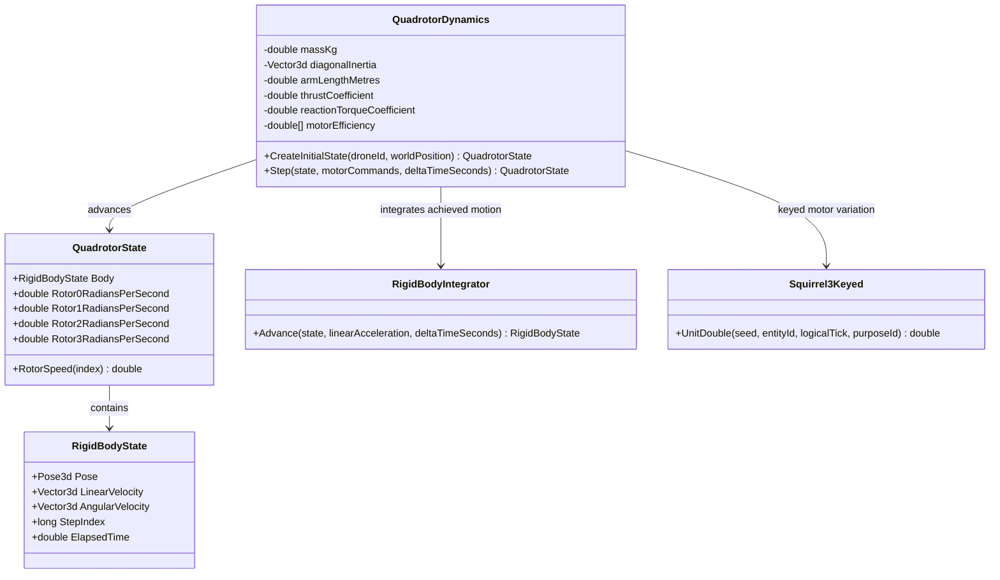

# QuadrotorDynamics — UML

## Use cases

- Apply four motor commands and calculate physically induced roll, pitch, yaw, and translation.
- Replay the same setup using a stable world seed and numeric drone identity.
- Keep authoritative achieved pose separate from requested commands and renderer interpolation.
- Test deterministic motion, symmetric thrust, invalid commands, and motor-induced torque.
