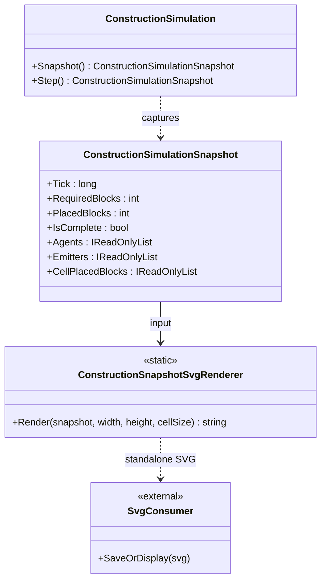

# ConstructionSnapshotSvgRenderer — UML and Use Cases

## UML class card

## Use cases

1. **Review a committed tick:** capture `simulation.Snapshot()`, render it, and retain the tick with the artifact.
2. **Inspect progress:** compare emitter inventory, agent location/carrying state, and placed-block counts in one view.
3. **Validate dimensions:** reject an input snapshot when its cell-count does not match the requested grid dimensions.
4. **Integrate later:** adapt the same snapshot into GUI.SVG or Renderer without making the simulation depend on a presentation package.

## Invariants

- Rendering is deterministic for the same snapshot and dimensions.
- Rendering is read-only; it never calls `Step()`.
- SVG labels identify the tick and placement progress.
- This renderer is a snapshot-to-SVG proof, not an autonomous lane-routing or 100k scale claim.
